# MMO Catch Records – Web Administration Portal: UI Implementation Brief

> **Instructions for Copilot (read first)**
>
> 1. This document and the screenshots in [`../admin-screens/`](../admin-screens/) are the source of truth for the admin UI.
> 2. Before implementing a page, **open its screenshot(s) with the image/view tool** and match layout, copy, components and spacing exactly.
> 3. Frontend UI only. Use mock data. Do not build a backend, database, API, real authentication or email sending.
> 4. Do not invent fields, validation rules or pages. Anything marked **`TBC`** must be confirmed with the team (Melissa). Until then, implement only what is visible and list it under "Outstanding issues".
> 5. Implement section by section in the order in §10. After each section, compare every page with its screenshot and output a summary. Stop for review before starting the next section.

- Prototype: <https://snd-mmo-fes-prototype-wa.azurewebsites.net/catch-records-v2/index> (password protected, GOV.UK Prototype Kit)
- Screenshots captured: 16 November 2026, desktop viewport 1280 px, signed in as the **Service Manager** role.
- Capture status: **Common** and **Users** are complete. **Vessels, Fishing trips, Trip breakdown, Trip layouts, Audit log, Banner message and Role previews have no screenshots yet** (see §9). Their pages and fields come from a crawl of the prototype's HTML.

---

## 1. Tech stack and conventions

| Item | Decision|

| Repo | `DEFRA/mmo-cr-internal-admin-frontend` (CDP Node.js frontend template): Node ≥ 24 (`.nvmrc` 24.22.3), Hapi, Nunjucks, `govuk-frontend` 6.6, Vite, SCSS, Joi 18, `@hapi/yar` |
| Route structure | Follow the template: `src/server/routes/<feature>/index.js` (Hapi plugin), `controller.js`, `*.njk` views, `*.test.js` beside them. Register each plugin in `src/server/plugins/router.js`. Shared macros go in `src/server/common/components/<name>/` (`macro.njk`, `template.njk`, `_<name>.scss`, as `heading` does). Layout: `src/server/common/templates/layouts/page.njk` |
| Components | GOV.UK Frontend macros first (`govukTable`, `govukSummaryList`, `govukTabs`, `govukPanel`, `govukNotificationBanner`, `govukErrorSummary`, `govukPagination`, `govukTag`, `govukBackLink`). Use a custom macro for the filter panel. For vessel and user search inputs use `accessible-autocomplete`. It is **not installed yet**, so add it with `npm i accessible-autocomplete` when building U9 |
| Local run | `npm run dev` serves on port 3000 by default. Use `PORT=3001 npm run dev` if the external frontend is already running on 3000 |
| Routes | lowercase kebab-case. Suggested mapping is in §4. Do not copy the prototype's ad-hoc names such as `landing-page` and `new-user-profile` |
| Mock data | Editable JSON in `src/server/common/mock-data/admin/` (`users.json`, `vessels.json`, `trips.json`, `audit-log.json`, `banner.json`, `roles.json`) |
| State | Session (`@hapi/yar`) holds created/amended users, vessel links, notes, the banner message and the selected preview role |
| Validation | Joi on POST. GOV.UK error summary plus inline errors. Keep entered values. Error text must match the screenshots exactly |
| Tests | Vitest: a render test for each route, plus validation and redirect tests for each form |

---

## 2. Screenshot manifest

Files are in [`../admin-screens/`](../admin-screens/). Each image shows one page in one state.

### 2.1 Common

| #   | Page                                  | State                 | File                                                                                                    |
| --- | ------------------------------------- | --------------------- | ------------------------------------------------------------------------------------------------------- |
| C1  | Portal home (back-office index)       | default               | [00-common-portal-home.png](../admin-screens/00-common-portal-home.png)                                 |
| C2  | Header (inner pages)                  | default, Users active | [01-common-header.png](../admin-screens/01-common-header.png)                                           |
| C3  | Footer (inner pages)                  | default               | [02-common-footer.png](../admin-screens/02-common-footer.png)                                           |
| C4  | Page not found (target of "Sign out") | 404                   | [03-common-page-not-found.png](../admin-screens/03-common-page-not-found.png)                           |
| C5  | Sign in                               | default               | [04-common-sign-in-default.png](../admin-screens/04-common-sign-in-default.png)                         |
| C6  | Sign in                               | validation errors     | [05-common-sign-in-errors.png](../admin-screens/05-common-sign-in-errors.png)                           |
| C7  | After sign in → portal home           | success               | [06-common-sign-in-success-destination.png](../admin-screens/06-common-sign-in-success-destination.png) |

### 2.2 Users (complete)

| #    | Page                                          | State                                 | File                                                                                                                                                                                                                                                                                                                                                                                                                         |
| ---- | --------------------------------------------- | ------------------------------------- | ---------------------------------------------------------------------------------------------------------------------------------------------------------------------------------------------------------------------------------------------------------------------------------------------------------------------------------------------------------------------------------------------------------------------------- |
| U1   | Users list                                    | default                               | [10-users-list-default.png](../admin-screens/10-users-list-default.png)                                                                                                                                                                                                                                                                                                                                                      |
| U1a  | Users list                                    | Filters panel open                    | [10a-users-list-filters-open.png](../admin-screens/10a-users-list-filters-open.png)                                                                                                                                                                                                                                                                                                                                          |
| U2   | Create a new user                             | default                               | [14-users-create-default.png](../admin-screens/14-users-create-default.png)                                                                                                                                                                                                                                                                                                                                                  |
| U2a  | Create a new user                             | all errors (empty submit)             | [15-users-create-errors.png](../admin-screens/15-users-create-errors.png)                                                                                                                                                                                                                                                                                                                                                    |
| U2b  | Create a new user                             | errors when assisted digital = Yes    | [15b-users-create-errors-assisted-digital.png](../admin-screens/15b-users-create-errors-assisted-digital.png)                                                                                                                                                                                                                                                                                                                |
| U2c  | Create a new user                             | filled (valid)                        | [16-users-create-filled.png](../admin-screens/16-users-create-filled.png)                                                                                                                                                                                                                                                                                                                                                    |
| U3   | User created (confirmation)                   | success                               | [17-users-create-confirmation.png](../admin-screens/17-users-create-confirmation.png)                                                                                                                                                                                                                                                                                                                                        |
| U4   | User profile, Accepted user                   | default (Vessels tab)                 | [20-users-profile-accepted.png](../admin-screens/20-users-profile-accepted.png)                                                                                                                                                                                                                                                                                                                                              |
| U4a  | User profile                                  | Vessels tab                           | [20-users-profile-accepted-tab-vessels.png](../admin-screens/20-users-profile-accepted-tab-vessels.png)                                                                                                                                                                                                                                                                                                                      |
| U4b  | User profile                                  | Fishing trips tab                     | [20-users-profile-accepted-tab-fishing-trips.png](../admin-screens/20-users-profile-accepted-tab-fishing-trips.png)                                                                                                                                                                                                                                                                                                          |
| U4c  | User profile                                  | History tab                           | [20-users-profile-accepted-tab-history.png](../admin-screens/20-users-profile-accepted-tab-history.png)                                                                                                                                                                                                                                                                                                                      |
| U4d  | User profile                                  | Notes tab (empty)                     | [20-users-profile-accepted-tab-notes.png](../admin-screens/20-users-profile-accepted-tab-notes.png)                                                                                                                                                                                                                                                                                                                          |
| U5   | User profile, Invited user                    | default + tabs                        | [21-users-profile-invited.png](../admin-screens/21-users-profile-invited.png), [vessels](../admin-screens/21-users-profile-invited-tab-vessels.png), [fishing trips](../admin-screens/21-users-profile-invited-tab-fishing-trips.png), [history](../admin-screens/21-users-profile-invited-tab-history.png), [notes](../admin-screens/21-users-profile-invited-tab-notes.png)                                                |
| U5a  | User profile, newly created user              | invited, with extra rows              | [21b-users-profile-newly-created.png](../admin-screens/21b-users-profile-newly-created.png)                                                                                                                                                                                                                                                                                                                                  |
| U6   | User profile, older template (`user-profile`) | reference only, see §11               | [22-users-profile-legacy-layout.png](../admin-screens/22-users-profile-legacy-layout.png), [vessels](../admin-screens/22-users-profile-legacy-layout-tab-vessels.png), [fishing trips](../admin-screens/22-users-profile-legacy-layout-tab-fishing-trips.png), [history](../admin-screens/22-users-profile-legacy-layout-tab-history.png), [notes with entry](../admin-screens/22-users-profile-legacy-layout-tab-notes.png) |
| U7   | Amend user                                    | default (pre-filled)                  | [25-users-amend-default.png](../admin-screens/25-users-amend-default.png)                                                                                                                                                                                                                                                                                                                                                    |
| U7a  | Amend user                                    | validation errors                     | [26-users-amend-errors.png](../admin-screens/26-users-amend-errors.png)                                                                                                                                                                                                                                                                                                                                                      |
| U7b  | User profile                                  | "User details updated" banner         | [26b-users-amend-saved.png](../admin-screens/26b-users-amend-saved.png)                                                                                                                                                                                                                                                                                                                                                      |
| U8   | Deactivate user?                              | confirmation                          | [27-users-deactivate-confirm.png](../admin-screens/27-users-deactivate-confirm.png)                                                                                                                                                                                                                                                                                                                                          |
| U8a  | User profile                                  | "User deactivated" banner             | [28-users-deactivate-success.png](../admin-screens/28-users-deactivate-success.png)                                                                                                                                                                                                                                                                                                                                          |
| U9   | Add a vessel (to user)                        | default                               | [29-users-add-vessel-default.png](../admin-screens/29-users-add-vessel-default.png)                                                                                                                                                                                                                                                                                                                                          |
| U9a  | Add a vessel                                  | autocomplete results                  | [30a-users-add-vessel-autocomplete.png](../admin-screens/30a-users-add-vessel-autocomplete.png)                                                                                                                                                                                                                                                                                                                              |
| U9b  | User profile                                  | "Vessel added" banner                 | [30b-users-add-vessel-success.png](../admin-screens/30b-users-add-vessel-success.png)                                                                                                                                                                                                                                                                                                                                        |
| U9c  | User profile                                  | vessel linked (table)                 | [30c-users-profile-with-vessel.png](../admin-screens/30c-users-profile-with-vessel.png)                                                                                                                                                                                                                                                                                                                                      |
| U10  | Remove a vessel                               | default                               | [31-users-remove-vessel-default.png](../admin-screens/31-users-remove-vessel-default.png)                                                                                                                                                                                                                                                                                                                                    |
| U10a | Remove a vessel                               | no linked vessels                     | [31c-users-remove-vessel-none-linked.png](../admin-screens/31c-users-remove-vessel-none-linked.png)                                                                                                                                                                                                                                                                                                                          |
| U11  | Fishing trips filtered by user                | from "View all fishing trips for …"   | [33-users-fishing-trips-by-user.png](../admin-screens/33-users-fishing-trips-by-user.png)                                                                                                                                                                                                                                                                                                                                    |
| U12  | Notes tab                                     | empty note submitted (no error shown) | [34-users-note-errors.png](../admin-screens/34-users-note-errors.png)                                                                                                                                                                                                                                                                                                                                                        |
| U12a | Notes tab                                     | note saved                            | [34b-users-note-saved.png](../admin-screens/34b-users-note-saved.png)                                                                                                                                                                                                                                                                                                                                                        |

### 2.3 Other sections: screenshots pending

These file names are reserved. Capture them before implementing each section (see §9).

| Section        | Reserved files                                                                                                                                                                                                                                                                                                                                                                                                  |
| -------------- | --------------------------------------------------------------------------------------------------------------------------------------------------------------------------------------------------------------------------------------------------------------------------------------------------------------------------------------------------------------------------------------------------------------- |
| Vessels        | `40-vessels-list-default`, `40a-vessels-list-filters-open`, `43-vessels-profile` (+ `-tab-users`, `-tab-fishing-trips`, `-tab-history`, `-tab-notes`), `44-vessels-add-user-default`, `44a-…-autocomplete`, `44b-…-success`, `45-vessels-remove-user-default`, `45b-…-success`, `46-vessels-note-saved`, `47-vessels-fishing-trips-for-vessel`                                                                  |
| Fishing trips  | `50-trips-list-default`, `50a-trips-list-filters-open`, `55-trips-profile-submitted` (+ `-tab-catch-breakdown`, `-tab-history`, `-tab-notes`), `55a-…-other-trip-information-open`, `55b-…-add-correction-open`, `55c-trips-amend-catch-recording`, `55d-trips-profile-original-version`, `56-trips-profile-amended`, `57-trips-profile-late`, `58-trips-version-history`, `59-trips-profile-amendment-version` |
| Trip breakdown | `60-trip-breakdown-default`, `60a-trip-breakdown-filters-open`                                                                                                                                                                                                                                                                                                                                                  |
| Trip layouts   | `65-trip-layout-option-1-concise`, `66-trip-layout-option-2-all-information`, `67-trip-layout-archive-index`, `68-trip-layout-archive-{as-is,b,b2,c,d,e,e2,f,f2}`                                                                                                                                                                                                                                               |
| Audit log      | `70-audit-log-default`, `70a-audit-log-filters-open`                                                                                                                                                                                                                                                                                                                                                            |
| Banner message | `80-banner-message-default`, `81-banner-message-empty-submit`, `82-banner-message-saved`                                                                                                                                                                                                                                                                                                                        |
| Role previews  | `90-role-{service-manager,fishing-vessel-licensing,helpline,compliance,other-operations,fdst,full-ops,compliance-with-licensing}`                                                                                                                                                                                                                                                                               |

---

## 3. Page inventory (discovered from the prototype)

| Section             | Pages                                                                                                                                                                                                                               |
| ------------------- | ----------------------------------------------------------------------------------------------------------------------------------------------------------------------------------------------------------------------------------- |
| Common              | Sign in · Portal home (back-office index) · Page not found                                                                                                                                                                          |
| Users               | Users list · Create a new user · User created · User profile (tabs: Vessels, Fishing trips, History, Notes) · Amend user · Deactivate user? · Reactivate user (link only) · Add a vessel · Remove a vessel                          |
| Vessels             | Vessels list (+ Export vessel data) · Vessel profile (tabs: Users, Fishing trips, History, Notes) · Add a user to {vessel} · Remove a user from {vessel}                                                                            |
| Fishing trips       | Fishing trips list · Trip profile (statuses Submitted / Amended / Late; tabs: Catch breakdown, History, Notes; Other trip information; Add correction; Amend catch recording; View original record; Download PDF) · Version history |
| Trip breakdown      | Trip breakdown list (catch entries by species)                                                                                                                                                                                      |
| Trip details layout | Option 1 (concise) · Option 2 (all information) · Archived layouts index + 9 archived variants. **These are design-comparison pages. Confirm whether to build them or to pick one layout for Trip profile (`TBC`)**                 |
| Audit log           | Audit log list (search + filters)                                                                                                                                                                                                   |
| Banner message      | Banner message edit page                                                                                                                                                                                                            |
| Role-based access   | 8 preview roles that change the visible navigation (`TBC`: exact permissions for each role)                                                                                                                                         |

---

## 4. Route map (prototype → recommended)

| Prototype URL                                 | Recommended route                                                                      | Page                      |
| --------------------------------------------- | -------------------------------------------------------------------------------------- | ------------------------- |
| `/sign-in`                                    | `/sign-in`                                                                             | Sign in                   |
| `/index`                                      | `/`                                                                                    | Portal home               |
| `/landing-page`                               | `/users`                                                                               | Users list                |
| `/create-user`                                | `/users/create`                                                                        | Create a new user         |
| `/create-user-confirmation?userId=`           | `/users/create/confirmation/{userId}`                                                  | User created              |
| `/new-user-profile?userId=`                   | `/users/{userId}` (tab hashes `#vessel-roles`, `#fishing-trips`, `#history`, `#notes`) | User profile              |
| `/edit-user?userId=`                          | `/users/{userId}/amend`                                                                | Amend user                |
| `/deactivate-user?userId=`                    | `/users/{userId}/deactivate`                                                           | Deactivate user?          |
| `/user-vessels?userId=&action=add`            | `/users/{userId}/vessels/add`                                                          | Add a vessel              |
| `/user-vessels?userId=&action=remove`         | `/users/{userId}/vessels/remove`                                                       | Remove a vessel           |
| `/user-note` (POST)                           | `/users/{userId}/notes` (POST)                                                         | Save note                 |
| `/vessels`                                    | `/vessels`                                                                             | Vessels list              |
| `/vessel-profile?vessel=`                     | `/vessels/{vesselId}`                                                                  | Vessel profile            |
| `/vessel-users?action=add&vessel=`            | `/vessels/{vesselId}/users/add`                                                        | Add a user to vessel      |
| `/vessel-users?action=remove&vessel=`         | `/vessels/{vesselId}/users/remove`                                                     | Remove a user from vessel |
| `/fishing-trips` (`?vessel=`, `?created-by=`) | `/fishing-trips`                                                                       | Fishing trips list        |
| `/trip-profile?trip=&status=&version=`        | `/fishing-trips/{tripId}` (`?version=`)                                                | Trip profile              |
| `/trip-amendments?trip=`                      | `/fishing-trips/{tripId}/versions`                                                     | Version history           |
| `/trip-breakdown`                             | `/trip-breakdown`                                                                      | Trip breakdown            |
| `/trip-layout-archive`                        | `TBC`                                                                                  | Archived layouts          |
| `/audit-log` (`?s=`)                          | `/audit-log`                                                                           | Audit log                 |
| `/banner-message`                             | `/banner-message`                                                                      | Banner message            |
| `/role-preview?role=`                         | `/role-preview/{role}` (prototype-only helper)                                         | Switch preview role       |

---

## 5. Common layout, reusable components and design tokens

### 5.1 Two page shells

| Shell               | Used by                                | Spec                                                                                                                                                                                                                                                                     | Screenshot |
| ------------------- | -------------------------------------- | ------------------------------------------------------------------------------------------------------------------------------------------------------------------------------------------------------------------------------------------------------------------------ | ---------- |
| `adminPublicLayout` | Sign in                                | Black header with the text "Web Administration Portal" only (no user block, no nav). Content in the standard GOV.UK 960 px container. Footer is the simple OGL footer                                                                                                    | C5         |
| `adminLayout`       | All signed-in pages except Portal home | Full-width black header (see 5.2). Content uses a **full-width container with ~30 px side gutters** (not 960 px). Back link sits above `<main>` when present. Footer as in 5.3                                                                                           | C2, U1     |
| Portal home         | `/`                                    | Standard GOV.UK header (blue GOV.UK rebrand bar, "Web Admin Portal" service name) and full GOV.UK footer ("Clear data", OGL, crown, © Crown copyright) in a 960 px container. **`TBC`: confirm whether the production home page keeps this style or uses `adminLayout`** | C1         |

### 5.2 Header (`adminHeader`)

- Background `#0b0c0c`, white text.
- Left: **"Web Administration Portal"** (bold, ~24 px) links to the Portal home.
- Right (right-aligned, stacked): **user name** (bold), email, `Role: {role name}`, then a **Sign out** link (underlined). Mock user: `Sam Smith`, `preview@example.test`, `Role: Service Manager`.
- A thin grey divider runs below, then the **section navigation** (`aria-label="Web Administration Portal sections"`): Users · Vessels · Fishing trips · Trip breakdown · Audit log · Banner message. Links are white and underlined. The active section is **bold with a thick white underline bar**. Set it from the section of the current route.
- Navigation items depend on the role (see §8.9).
- "Sign out" goes to a 404 in the prototype. **Implement it as: clear session → redirect to `/sign-in` (`TBC`)**.

### 5.3 Footer (`adminFooter`)

Light grey background (`#f3f2f1`) with a **blue top border** (~10 px, `#1d70b8`). One line: OGL logo + "All content is available under the [Open Government Licence v3.0](https://www.nationalarchives.gov.uk/doc/open-government-licence/version/3/), except where otherwise stated". No crown or copyright on inner pages.

### 5.4 Shared macros (build once, reuse in every section)

| Macro                                                | Purpose                                                                                                                                                                                                                                                                                                                           | Seen in                                                  |
| ---------------------------------------------------- | --------------------------------------------------------------------------------------------------------------------------------------------------------------------------------------------------------------------------------------------------------------------------------------------------------------------------------- | -------------------------------------------------------- |
| `adminSearch({ label, hint, name, value })`          | Bold label, grey hint (can be multi-line), wide text input, square **blue search-icon button**                                                                                                                                                                                                                                    | Users, Vessels, Fishing trips, Trip breakdown, Audit log |
| `adminFilterPanel({ groups, applyText, clearText })` | Grey **"Filters"** secondary button to the right of the search. Opens a **floating panel** (light grey `#f3f2f1`, shadow) anchored top-right over the table, with a "Filters" heading, an **"x"** close button, scrollable checkbox and text groups, then **Apply filters** (green) + **Clear filters** (secondary, black border) | U1a                                                      |
| `adminTable({ caption, head, rows, emptyText })`     | GOV.UK table. First column is a link. Wrapped in a horizontally scrollable region labelled "{Name} table, scroll to see more columns"                                                                                                                                                                                             | U1, U9c                                                  |
| `statusTag(status)`                                  | Users: **Accepted** = green (`govuk-tag--green`), **Invited** = pink (`--pink`), **Created** = grey (`--grey`), **Deactivated** = grey. Roles: **Available** = green, **New** = blue. Vessels: Active / Inactive (`TBC` colours). Trips: Submitted / Amended / Late (`TBC` colours)                                               | U1, U4, U8a, C1                                          |
| `channelDateCell(channel, date)`                     | Two lines: channel (Web / App / Helpline) on top, date below in secondary grey                                                                                                                                                                                                                                                    | U1                                                       |
| `adminPagination`                                    | GOV.UK pagination: numbered pages, current page as a filled blue square, **Next** link. 10 rows per page                                                                                                                                                                                                                          | U1                                                       |
| `profileHeader({ caption, title })`                  | Grey caption ("User profile") above a large H1 (the name)                                                                                                                                                                                                                                                                         | U4                                                       |
| `profileSummary(rows)`                               | GOV.UK summary list without borders on the key column, ~2/3 width                                                                                                                                                                                                                                                                 | U4                                                       |
| `profileTabs(tabs)`                                  | `govukTabs`. Each panel has an H2 matching the tab name, an action-button row and a table or empty text                                                                                                                                                                                                                           | U4a–d                                                    |
| `historyTable(events)`                               | Columns: **Date and time**, **Action**, **Performed by**                                                                                                                                                                                                                                                                          | U4c                                                      |
| `notesPanel({ notes, action })`                      | "Add a note" textarea + **Save note** button. Notes listed newest first as `{author} ({role}) — {d MMMM yyyy, HH:mm}` followed by the text. Empty text: "No notes recorded for this user."                                                                                                                                        | U4d, U12a                                                |
| `successBanner({ title, text })`                     | `govukNotificationBanner` with `type: 'success'` (green border), e.g. "User details updated", "Vessel added", "User deactivated"                                                                                                                                                                                                  | U7b, U9b, U8a                                            |
| `confirmationPanel`                                  | `govukPanel` (green), about 2/3 width                                                                                                                                                                                                                                                                                             | U3                                                       |
| `formActions({ primary, cancelHref })`               | Green primary button + **Cancel** (on the create form this is a secondary button; on other forms it is a link). Match each screenshot                                                                                                                                                                                             | U2, U7, U8, U9, U10                                      |
| `entityAutocomplete({ label, hint, source })`        | `accessible-autocomplete` over a hidden `<select>`. Hint "Search by vessel name, PLN or RSS number." Shows a result count ("1 vessels found."). Rejects free text with "Select a vessel from the results"                                                                                                                         | U9, U9a, U10                                             |

### 5.5 Design tokens

| Token       | Value                                                                                                                                                                                                                                                                                     |
| ----------- | ----------------------------------------------------------------------------------------------------------------------------------------------------------------------------------------------------------------------------------------------------------------------------------------- |
| Colours     | GOV.UK palette: text `#0b0c0c`, secondary text `#505a5f`, link `#1d70b8`, primary button green `#00703c`, warning button red `#d4351c`, secondary button grey `#f3f2f1`, borders `#b1b4b6`                                                                                                |
| Typography  | Inner pages render in a Helvetica/Arial stack. The portal home renders in GDS Transport. **`TBC`: confirm the font for production (GOV.UK services normally use GDS Transport via govuk-frontend)**                                                                                       |
| Headings    | H1 large/XL (e.g. "Users", "Create a new user"), section H2 medium, tab-panel H2 large                                                                                                                                                                                                    |
| Buttons     | Primary green (Create a new user, Create user and send invitation, Save changes, Add a vessel, Apply filters, Save note, Deactivate user `TBC` warning?). Secondary grey (Amend user, Filters, Cancel). Warning red (Remove a vessel). Start button with chevron (Access catch recording) |
| Breakpoints | GOV.UK defaults. Tables scroll horizontally on small screens                                                                                                                                                                                                                              |

---

## 6. Page specifications: Common

### C5/C6. Sign in (`/sign-in`)

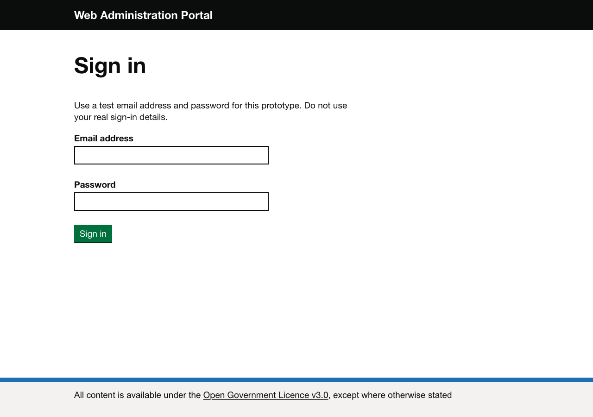
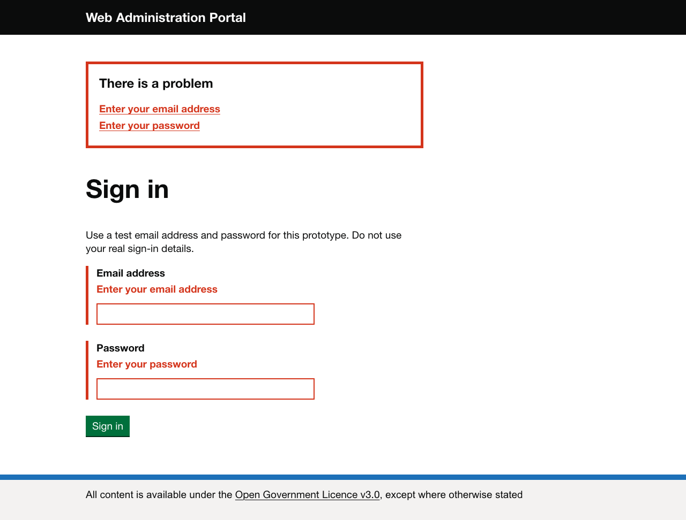

- H1 **Sign in**. Body text: "Use a test email address and password for this prototype. Do not use your real sign-in details."
- Fields: **Email address** (email, required), **Password** (password, required). Button: **Sign in**.
- Errors: "Enter your email address", "Enter your password".
- Success: any non-empty values sign in (mock) → Portal home `/`. Mock signed-in user: Sam Smith, preview@example.test, role Service Manager.
- Signed-out users who open any admin route are redirected here.
- Future dependency: real identity provider (Defra ID / Entra, `TBC`).

### C1. Portal home (`/`)

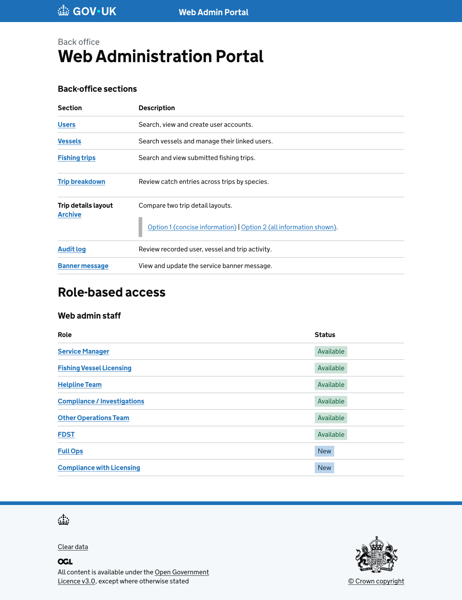

- Caption "Back office" with H1 **Web Administration Portal**.
- Table **Back-office sections** (Section | Description):
  - Users: "Search, view and create user accounts."
  - Vessels: "Search vessels and manage their linked users."
  - Fishing trips: "Search and view submitted fishing trips."
  - Trip breakdown: "Review catch entries across trips by species."
  - Trip details layout + Archive link: "Compare two trip detail layouts." Inset: Option 1 (concise information) | Option 2 (all information shown).
  - Audit log: "Review recorded user, vessel and trip activity."
  - Banner message: "View and update the service banner message."
- H2 **Role-based access** with the table **Web admin staff** (Role | Status). Each role links to a role preview: Service Manager, Fishing Vessel Licensing, Helpline Team, Compliance / Investigations, Other Operations Team, FDST (all "Available", green), plus Full Ops and Compliance with Licensing ("New", blue).

### C4. Page not found

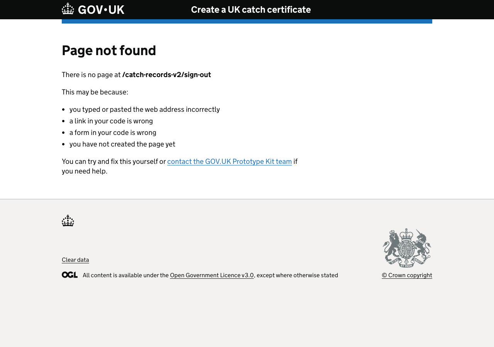
Standard "Page not found" page inside the admin layout.

---

## 7. Page specifications: Users (complete)

### U1. Users list (`/users`)

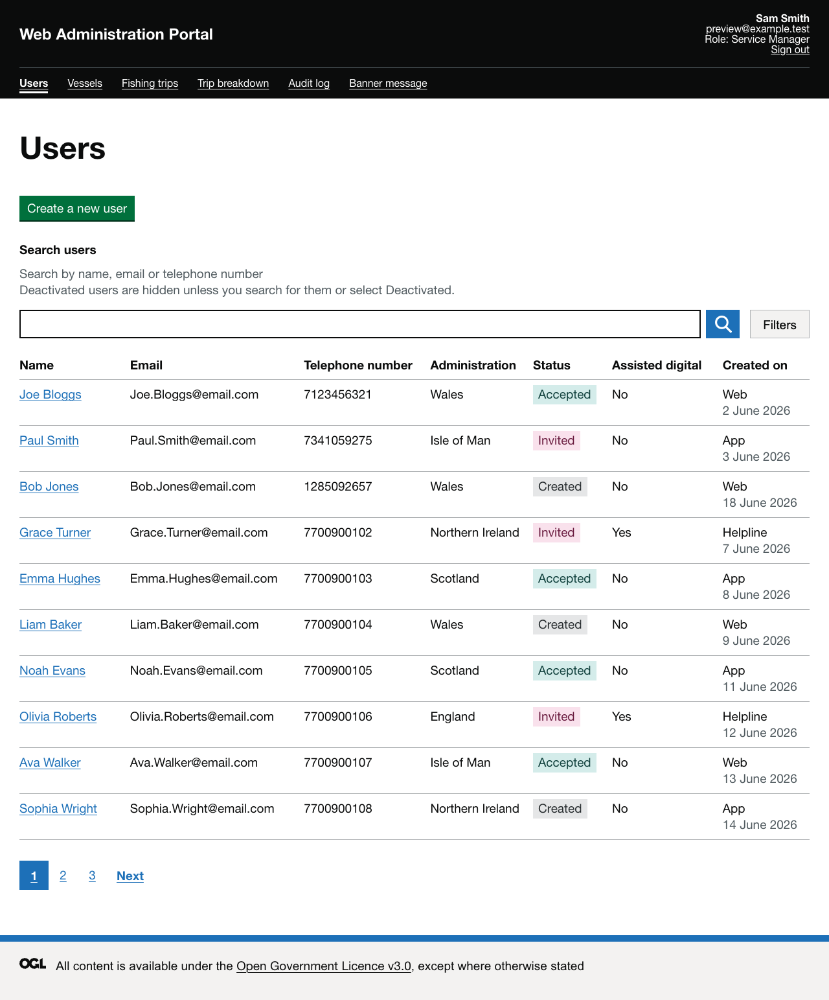
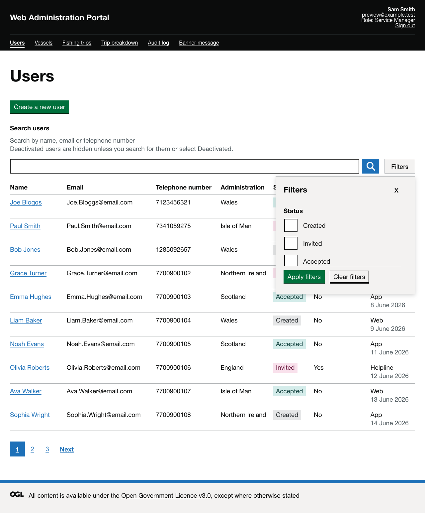

- **Entry:** "Users" in the header nav, or the Users link on Portal home.
- H1 **Users** → green button **Create a new user** (→ U2).
- Search: label **Search users**, hint "Search by name, email or telephone number" and, on a new line, "Deactivated users are hidden unless you search for them or select Deactivated." Text input + blue search icon button + **Filters** button.
- Filters panel groups (checkboxes):
  - **Status**: Created, Invited, Accepted, Deactivated
  - **Assisted digital**: Yes, No
  - **Administration**: England, Northern Ireland, Scotland, Wales, Isle of Man
  - Buttons: **Apply filters**, **Clear filters**. **x** closes the panel.
- Table columns: **Name** (link → profile) · **Email** · **Telephone number** · **Administration** · **Status** (tag) · **Assisted digital** (Yes/No) · **Created on** (channel + date).
- Behaviour:
  - Deactivated users are excluded by default. They appear when the search matches them or when the Deactivated filter is selected.
  - Search matches name, email or telephone (case-insensitive, partial).
  - Filters combine with AND across groups and OR within a group.
  - Empty result text: `TBC` (not captured). Suggested: "No users found."
  - 10 rows per page.
- Mock data (exact seed values from the prototype):

| ID   | Name           | Email                    | Telephone  | Administration   | Status   | AD  | Channel  | Created      |
| ---- | -------------- | ------------------------ | ---------- | ---------------- | -------- | --- | -------- | ------------ |
| 1234 | John Smith     | John.Smith@email.com     | 1234567890 | England          | Accepted | No  | `TBC`    | 1 June 2026  |
| 1235 | Joe Bloggs     | Joe.Bloggs@email.com     | 7123456321 | Wales            | Accepted | No  | Web      | 2 June 2026  |
| 1236 | Paul Smith     | Paul.Smith@email.com     | 7341059275 | Isle of Man      | Invited  | No  | App      | 3 June 2026  |
| —    | Bob Jones      | Bob.Jones@email.com      | 1285092657 | Wales            | Created  | No  | Web      | 18 June 2026 |
| —    | Grace Turner   | Grace.Turner@email.com   | 7700900102 | Northern Ireland | Invited  | Yes | Helpline | 7 June 2026  |
| —    | Emma Hughes    | Emma.Hughes@email.com    | 7700900103 | Scotland         | Accepted | No  | App      | 8 June 2026  |
| —    | Liam Baker     | Liam.Baker@email.com     | 7700900104 | Wales            | Created  | No  | Web      | 9 June 2026  |
| —    | Noah Evans     | Noah.Evans@email.com     | 7700900105 | Scotland         | Accepted | No  | App      | 11 June 2026 |
| —    | Olivia Roberts | Olivia.Roberts@email.com | 7700900106 | England          | Invited  | Yes | Helpline | 12 June 2026 |
| —    | Ava Walker     | Ava.Walker@email.com     | 7700900107 | Isle of Man      | Accepted | No  | Web      | 13 June 2026 |
| —    | Sophia Wright  | Sophia.Wright@email.com  | 7700900108 | Northern Ireland | Created  | No  | App      | 14 June 2026 |

Also seed Frank Castle (1237), Peter Petrelli (1238), Alice Wilson (1239) and Ethan Adams (1431). They exist in the prototype on pages 2–3. Give every user a working profile link; in the prototype some rows link to `#`.

### U2. Create a new user (`/users/create`)

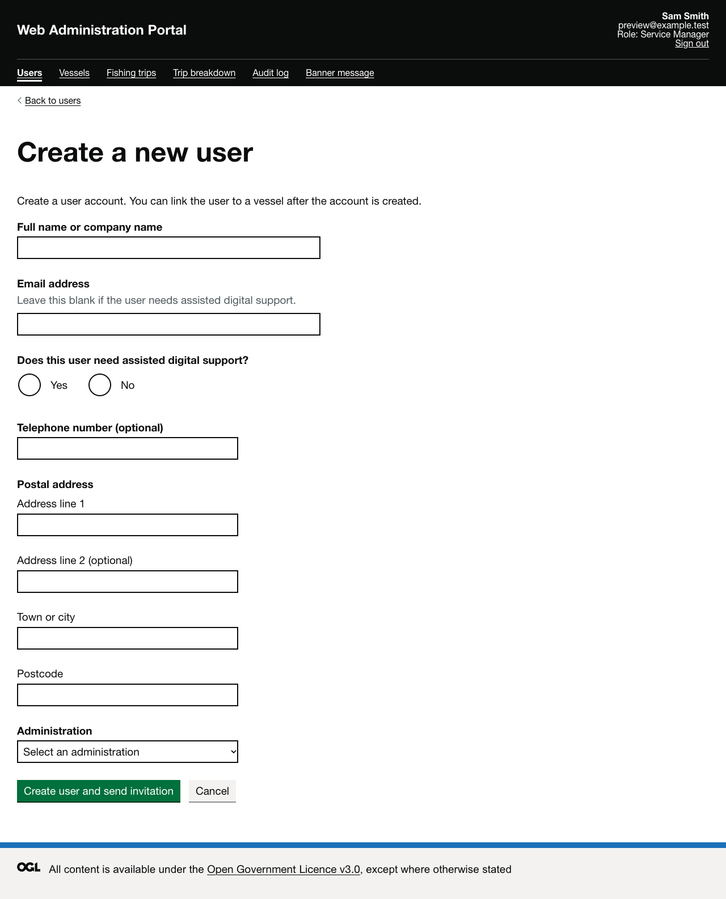
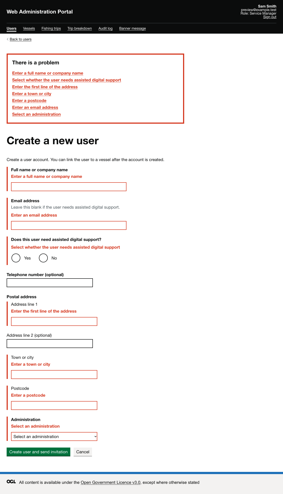
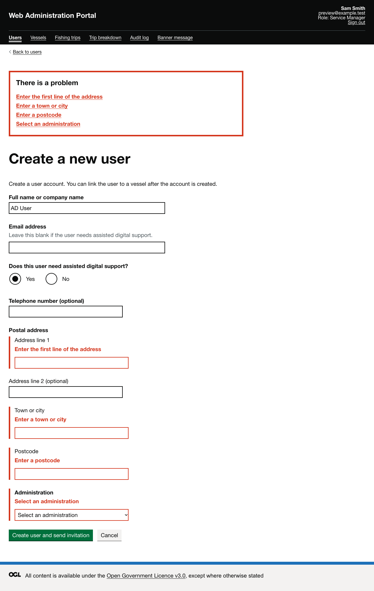
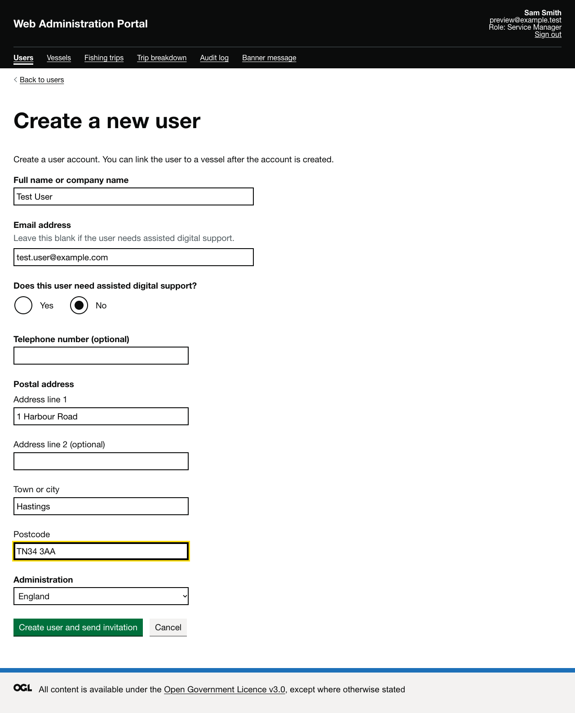

- Back link **Back to users** → U1. H1 **Create a new user**. Body text: "Create a user account. You can link the user to a vessel after the account is created."

| Field                                         | Name                | Type                                                                                        | Required                               | Hint                                                           | Error message                                          |
| --------------------------------------------- | ------------------- | ------------------------------------------------------------------------------------------- | -------------------------------------- | -------------------------------------------------------------- | ------------------------------------------------------ |
| Full name or company name                     | `full-name`         | text                                                                                        | Yes                                    | —                                                              | Enter a full name or company name                      |
| Email address                                 | `email-address`     | email                                                                                       | Yes, **unless assisted digital = Yes** | "Leave this blank if the user needs assisted digital support." | Enter an email address (format error text `TBC`)       |
| Does this user need assisted digital support? | `assisted-digital`  | radios Yes / No                                                                             | Yes                                    | —                                                              | Select whether the user needs assisted digital support |
| Telephone number (optional)                   | `telephone-number`  | tel                                                                                         | No                                     | —                                                              | —                                                      |
| _Postal address_ (fieldset legend)            |                     |                                                                                             |                                        |                                                                |                                                        |
| Address line 1                                | `address-line-1`    | text                                                                                        | Yes                                    | —                                                              | Enter the first line of the address                    |
| Address line 2 (optional)                     | `address-line-2`    | text                                                                                        | No                                     | —                                                              | —                                                      |
| Town or city                                  | `address-town-city` | text                                                                                        | Yes                                    | —                                                              | Enter a town or city                                   |
| Postcode                                      | `address-postcode`  | text                                                                                        | Yes                                    | —                                                              | Enter a postcode (format rule `TBC`)                   |
| Administration                                | `administration`    | select: "Select an administration", England, Wales, Scotland, Northern Ireland, Isle of Man | Yes                                    | —                                                              | Select an administration                               |

- Error summary order: full name, assisted digital, address line 1, town or city, postcode, email, administration (as in U2a).
- Buttons: **Create user and send invitation** (primary) and **Cancel** (secondary → U1, discard input).
- On success, create the user in the session with status **Invited**, channel Web, created today, invitation email "Sent (simulated)" → U3.

### U3. User created (`/users/create/confirmation/{userId}`)

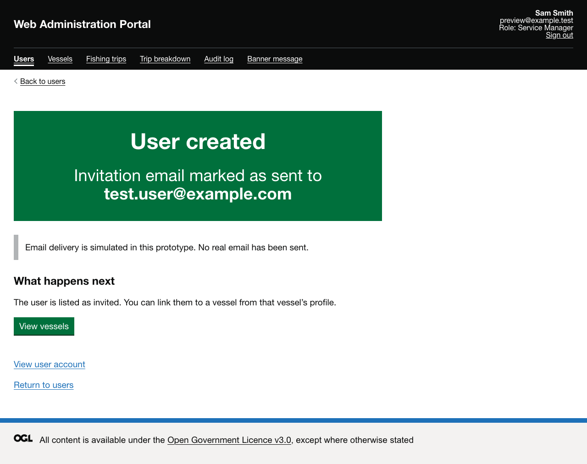

- Back link **Back to users**.
- Panel title **User created**. Body: "Invitation email marked as sent to **{email}**".
- Inset text: "Email delivery is simulated in this prototype. No real email has been sent." (`TBC`: remove or reword for production.)
- H2 **What happens next**. Body: "The user is listed as invited. You can link them to a vessel from that vessel's profile."
- Green button **View vessels** (→ Vessels list). Links: **View user account** (→ U4 for the new user) and **Return to users** (→ U1).
- Future dependency: invitation email service.

### U4/U5. User profile (`/users/{userId}`)

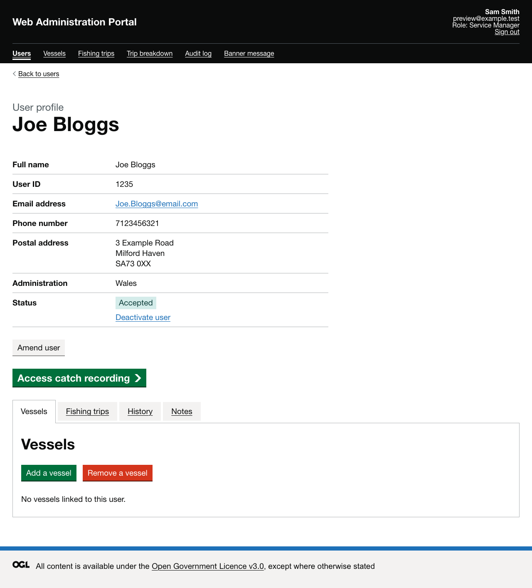
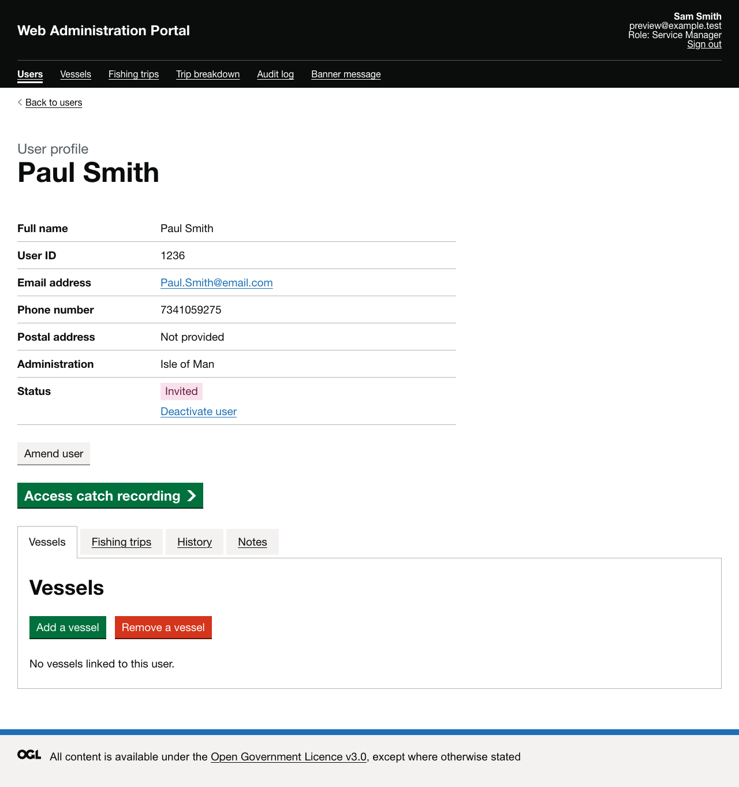
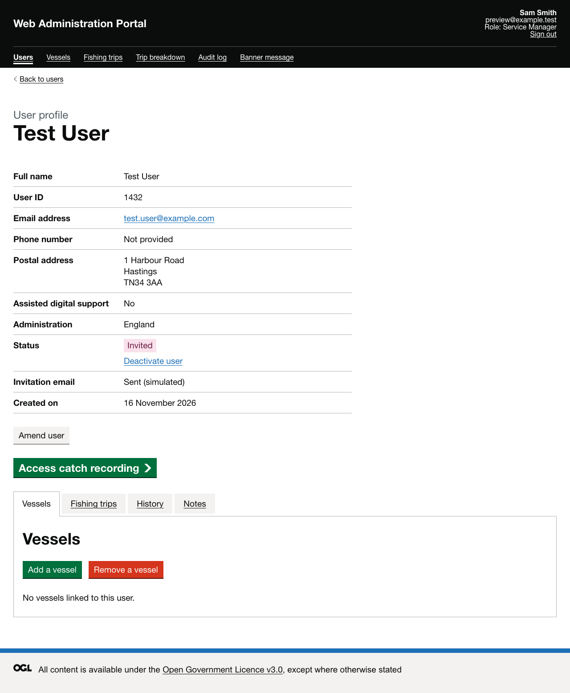

- Back link **Back to users**. Caption "User profile", H1 = full name.
- Summary rows: **Full name**, **User ID**, **Email address** (mailto link), **Phone number** ("Not provided" if empty), **Address** (multi-line including county, "Not provided" if empty), **Status** (tag, with a **Deactivate user** link below it, or **Reactivate user** when deactivated), **Assisted digital status**, **Administration**, **Created on**.
- Users created in this session show extra rows (U5a): **Assisted digital support**, **Invitation email: Sent (simulated)**, **Created on**. **`TBC`: confirm the final row set** (older template U6 shows Assisted digital status + Created on for every user).
- Buttons: **Amend user** (secondary → U7) and **Access catch recording ›** (start button). Its destination is `#` in the prototype, so it is **`TBC`**.
- Tabs:
  - **Vessels** (`#vessel-roles`): H2 "Vessels". Buttons **Add a vessel** (green → U9) and **Remove a vessel** (red → U10). Table columns **Vessel** (link → vessel profile), **Vessel reference**, **User role**, **Linked on**. Empty: "No vessels linked to this user."
  - **Fishing trips**: H2 "Fishing trips". Table of the user's trips (columns as in Fishing trips list `TBC`). Empty: "No fishing trips recorded for this user." Link **View all fishing trips for {name}** → `/fishing-trips?created-by={name}` (U11).
  - **History**: table **Date and time | Action | Performed by**, newest first. Example: "16 June 2026, 16:54 · Trip submitted via Web · Joe Bloggs" and "2 June 2026, 09:00 · User created · Maia Bates".
  - **Notes**: label "Add a note", textarea, **Save note**. Notes list (U12a). Empty: "No notes recorded for this user." Saving an empty note shows **no error** in the prototype (U12). **`TBC`: add "Enter a note"?**
- Success banners shown after redirects: "User details updated" (U7b), "Vessel added" (U9b), "User deactivated" with text "{name} can no longer access the service. Their records have been kept." (U8a).

### U7. Amend user (`/users/{userId}/amend`)

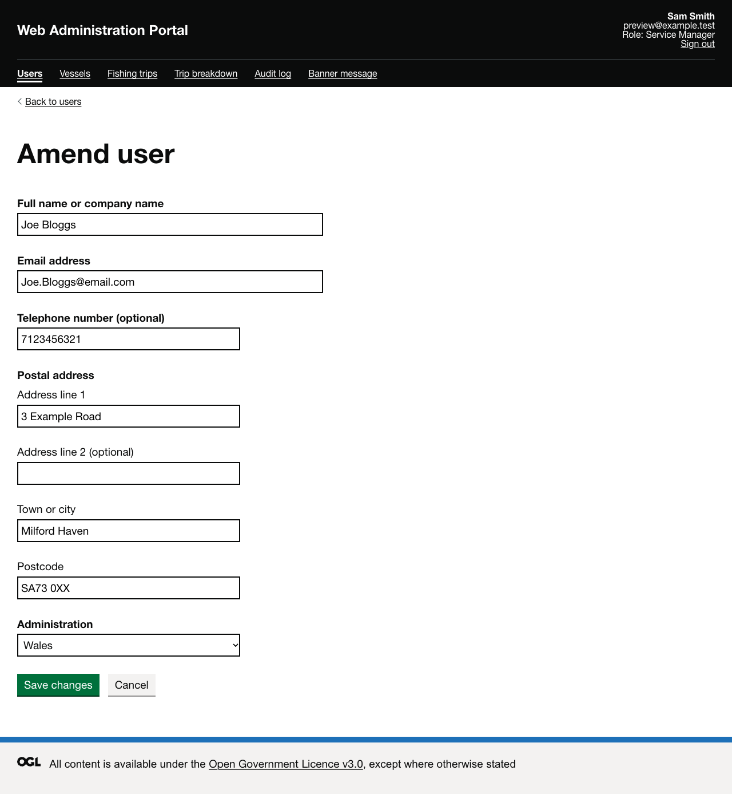
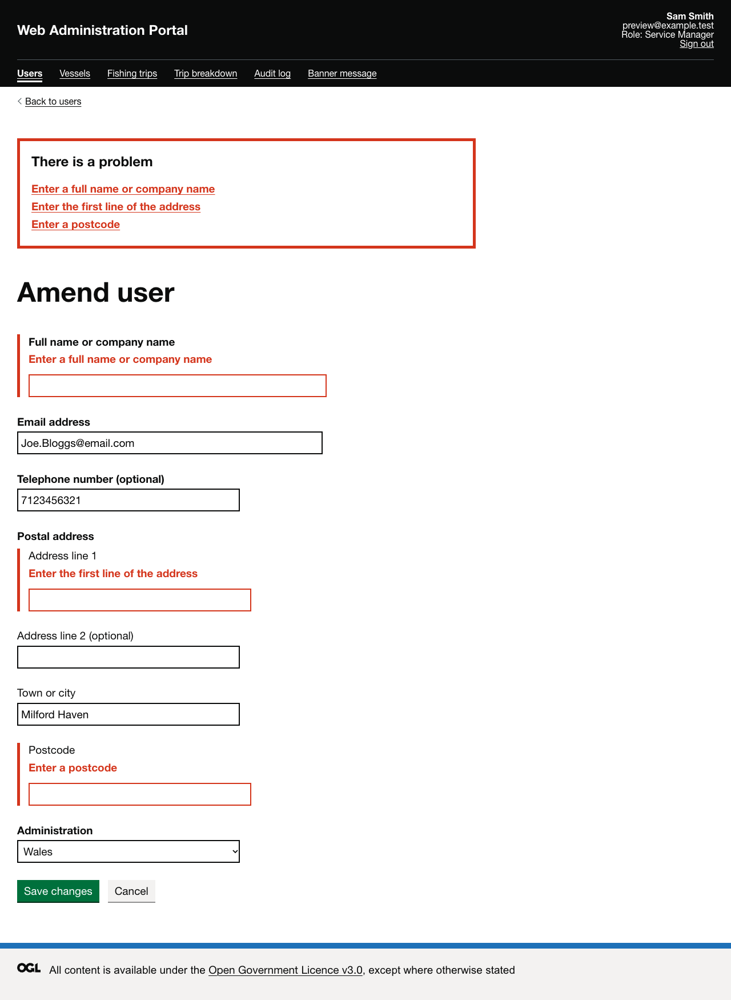
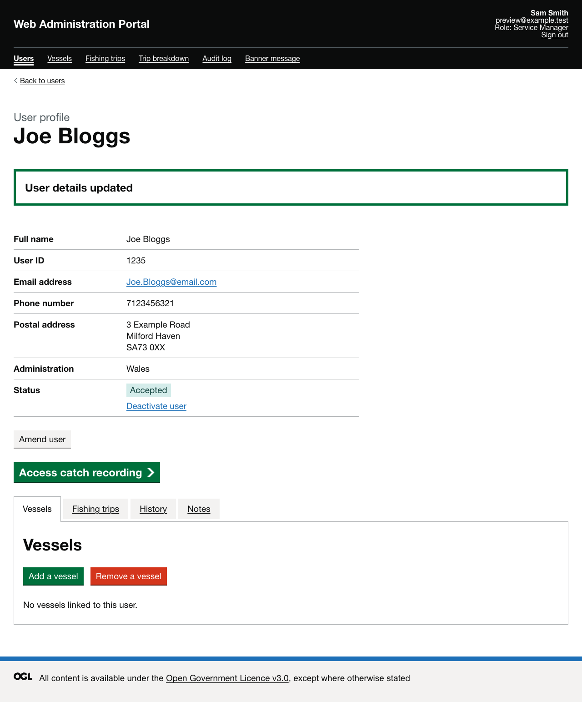

- H1 **Amend user**. Same fields as U2, pre-filled, **except there is no assisted digital question**.
- Same required fields and error messages as U2 (U7a shows full name, address line 1 and postcode).
- **Save changes** → profile with the success banner "User details updated". **Cancel** → profile.
- Add a History entry "User details amended" (`TBC` wording).

### U8. Deactivate user? (`/users/{userId}/deactivate`)

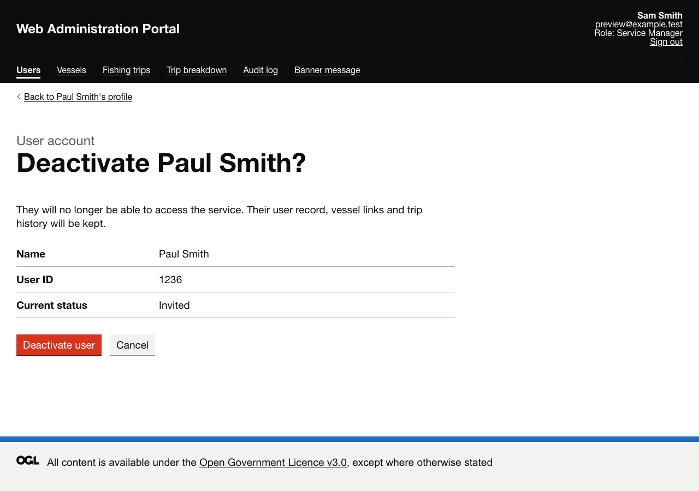
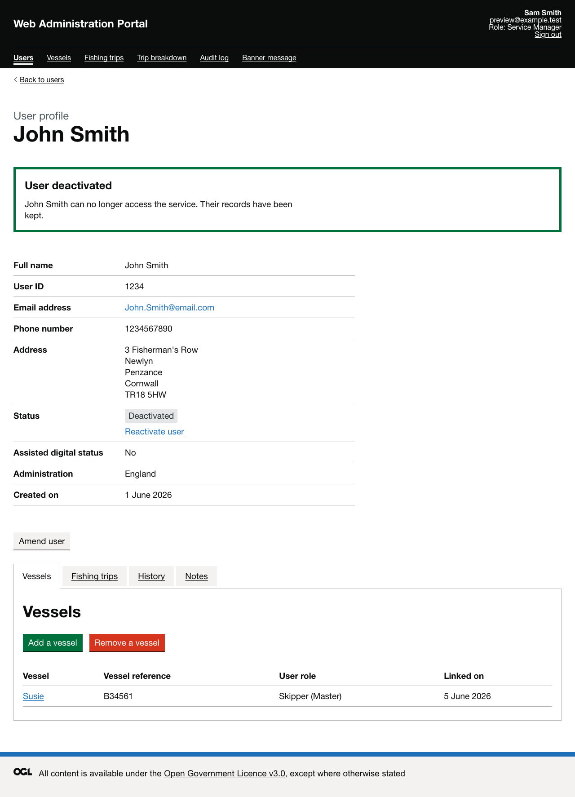

- Caption "User account", H1 **Deactivate {name}?** Body: "They will no longer be able to access the service. Their user record, vessel links and trip history will be kept."
- Summary rows: Name, User ID, Current status.
- **Deactivate user** (button) → profile with status **Deactivated**, a **Reactivate user** link and the "User deactivated" banner. **Cancel** → profile.
- Reactivate: the prototype only has a link. Its flow is **`TBC`** (suggested: mirror the deactivate confirmation, then return to Accepted).
- Note: the prototype shows the wrong person ("John Smith") after deactivating Paul Smith. That is a prototype bug. Show the deactivated user.

### U9. Add a vessel (`/users/{userId}/vessels/add`)

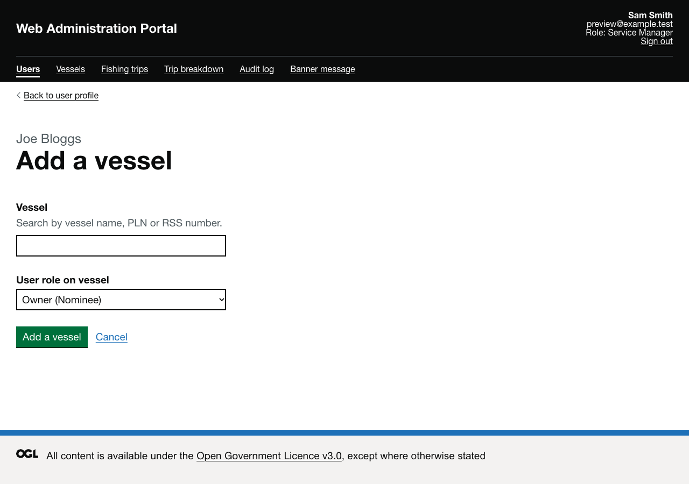
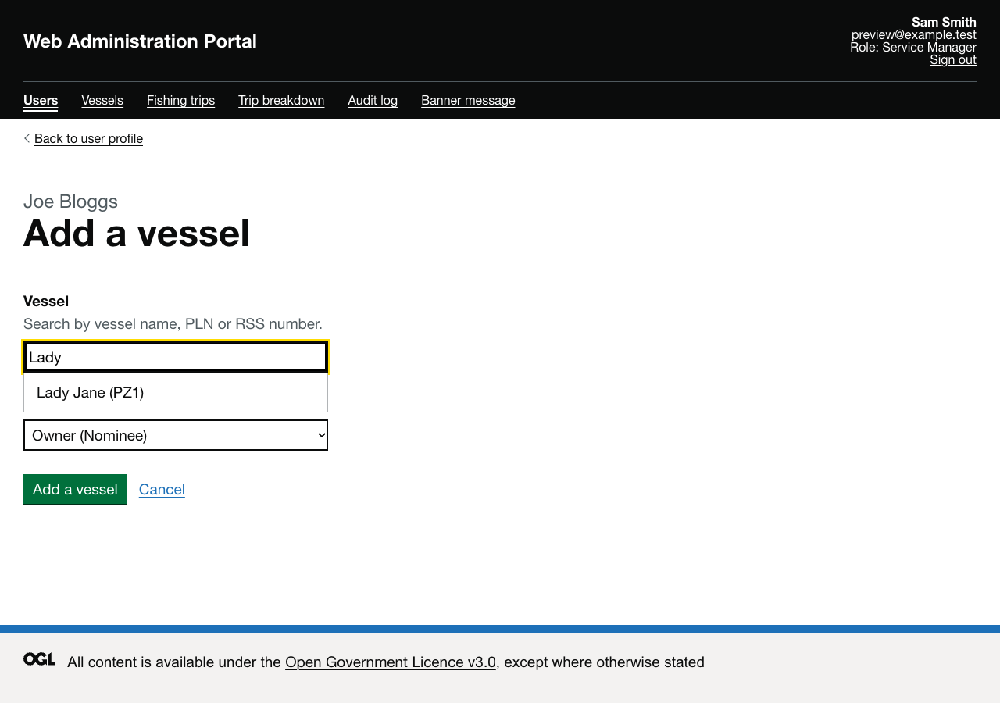
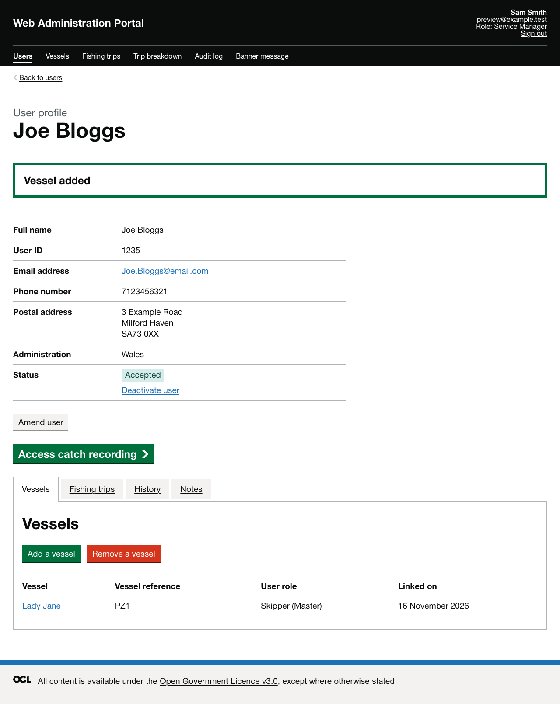
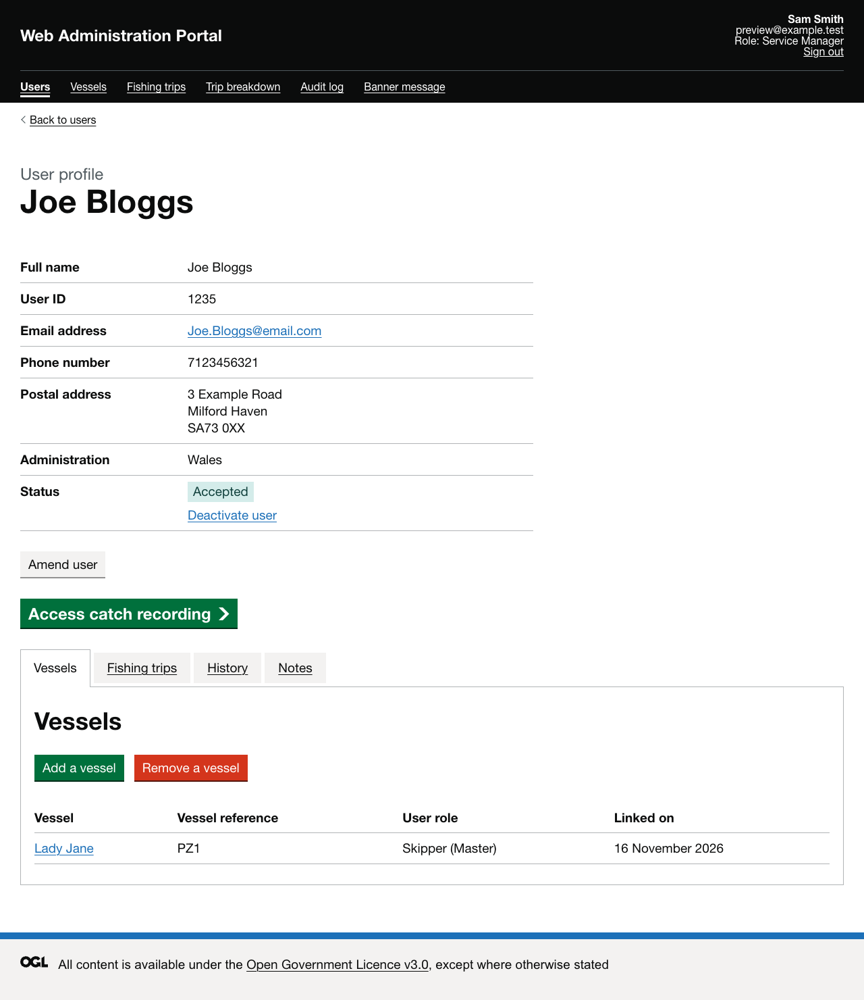

- Back link **Back to user profile**. Caption = user name, H1 **Add a vessel**.
- **Vessel**: autocomplete, hint "Search by vessel name, PLN or RSS number." Options are shown as `Name (PLN)`: Lady Jane (PZ1), Quatro (WY43), Sea Otter (RX09), Northern Star (PZ45), Bubbles (PZ99), …
- **User role on vessel**: select with Owner (Nominee) and Skipper (Master).
- Buttons: **Add a vessel** and **Cancel** (link → profile).
- Validation: free text not chosen from the list gives "Select a vessel from the results". Server-side messages are `TBC`. Suggested: "Select a vessel" and "Select a user role".
- Success → profile with the "Vessel added" banner. A row appears in the Vessels tab: Vessel, Vessel reference, User role, Linked on (today).

### U10. Remove a vessel (`/users/{userId}/vessels/remove`)

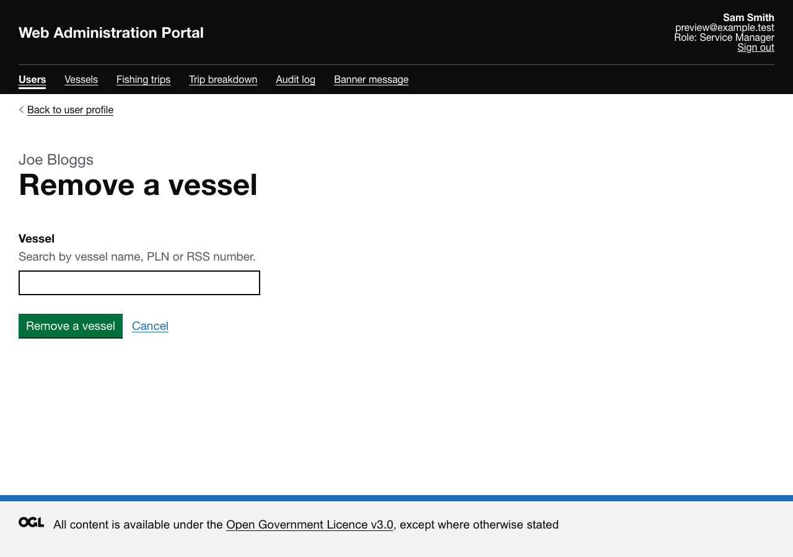
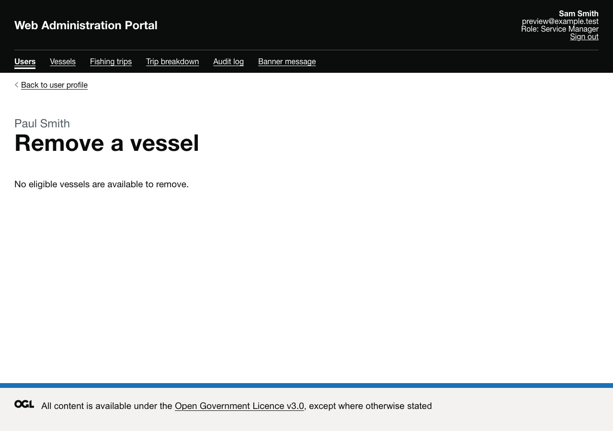

- Back link **Back to user profile**. Caption = user name, H1 **Remove a vessel**.
- **Vessel** autocomplete, limited to vessels linked to this user. Buttons: **Remove a vessel** and **Cancel** (link).
- If the user has no linked vessels, show "No eligible vessels are available to remove." with no form.
- Success: back to the profile with a banner (`TBC` wording, suggested "Vessel removed").

### U11. Fishing trips for a user

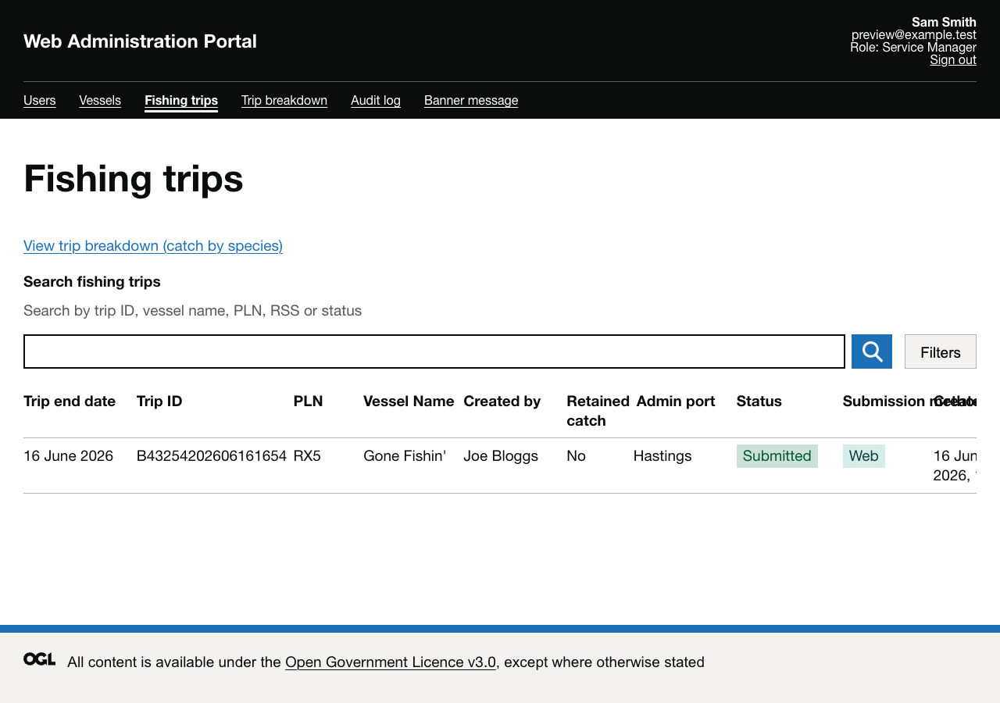
This is the Fishing trips list pre-filtered by `created-by={name}`. Build it in the Fishing trips section and reuse it here.

---

## 8. Page specifications: other sections (from the crawl, screenshots pending)

> Capture the screenshots in §2.3 and finish these specs before implementing them. The fields and copy below come from the prototype's HTML.

### 8.1 Vessels list (`/vessels`)

- H1 **Vessels**, button **Export vessel data** (`TBC`: CSV download behaviour).
- Search **Search vessels**, hint "Search by vessel name, PLN, RSS or CFR number", plus a Filters panel. Filter fields: **Vessel** (text), **Admin port** (text), **Status** (checkboxes: Active/Inactive), **Administration** (checkboxes).
- Columns: **Vessel** (link) · **PLN** · **RSS** · **Administration** · **Admin port** · **Port code** · **CFR number** · **Status**. 10 rows per page.
- Seed (page 1):

| Vessel        | PLN  | RSS    | Admin            | Admin port    | Port code | CFR          | Status   |
| ------------- | ---- | ------ | ---------------- | ------------- | --------- | ------------ | -------- |
| Lady Jane     | PZ1  | X10001 | England          | Newlyn        | GBNLY     | GBR000198765 | Active   |
| Quatro        | WY43 | Q12345 | Wales            | Milford Haven | GBMLF     | GBR000100020 | Active   |
| Obsession     | FR56 | RSS456 | Scotland         | Fraserburgh   | FR        | GBR000456789 | Active   |
| Morning Star  | GY23 | RSS789 | England          | Grimsby       | GY        | GBR000789012 | Active   |
| Sea Bird      | LT89 | RSS234 | England          | Lowestoft     | LT        | GBR000234567 | Active   |
| Ocean Pearl   | MH12 | RSS567 | Wales            | Milford Haven | MH        | GBR000567890 | Inactive |
| Silver Wave   | BA45 | RSS890 | Northern Ireland | Kilkeel       | KL        | GBR000890123 | Active   |
| Northern Star | PZ45 | X10002 | England          | Newlyn        | GBNLY     | GBR000100001 | Active   |
| Sea Spray     | FR12 | X10003 | Scotland         | Fraserburgh   | FR        | GBR000100002 | Active   |
| Kingfisher    | GY67 | X10004 | England          | Grimsby       | GY        | GBR000100003 | Inactive |

### 8.2 Vessel profile (`/vessels/{vesselId}`)

- H1 = vessel name. Vessel summary rows are `TBC` from the screenshot.
- Tabs: **Users** (Add a user / Remove a user buttons + linked users table) · **Fishing trips** (filters: Trip end date day/month/year, User, Status; Apply filters / Clear filters) · **History** · **Notes** (textarea `new-note`, **Save note**, **Cancel correction**).
- Link to `/fishing-trips?vessel={name}`.

### 8.3 Add a user to {vessel} / Remove a user from {vessel}

- Add: user autocomplete (`user-id`), **role** radios (Owner (Nominee) / Skipper (Master) `TBC`), button **Add user to vessel**.
- Remove: radios listing the linked users (`user-id`), button **Remove user from vessel**.

### 8.4 Fishing trips list (`/fishing-trips`)

- H1 **Fishing trips**, link **View trip breakdown (catch by species)**.
- Search **Search fishing trips**, hint "Search by trip ID, vessel name, PLN, RSS or status".
- Filters: **Trip end date from** and **to** (GOV.UK date inputs, day/month/year), **Vessel**, **Created by**, **Status** (Submitted / Amended / Late), **Submission method** (Web / App / Helpline).
- Columns: **Trip end date** · **Trip ID** (link) · **PLN** · **Vessel name** · **Created by** · **Retained catch** · **Admin port** · **Status** · **Submission method** · **Created on**.
- Query parameters `vessel` and `created-by` pre-filter the list (used from the profiles).
- Seed trip IDs: J12345202608301410, I12345202608281410, H12345202608261410, G12345202608241410, F34245202608221410, E45352202608201402, D12345202608181401, C34245202608171402, B43254202606161654 (Gone Fishin', RX5, Joe Bloggs, Hastings, Web), A45352202606151201 (amended), A12345202606151302 (amended), C54235202606161532 (late).

### 8.5 Trip profile (`/fishing-trips/{tripId}`)

- H1 **Trip {tripId}**. Status variants: Submitted, Amended, Late.
- Expandable **Other trip information**. Actions: **Amend catch recording** (`TBC` destination), **Add correction** (shows an inline correction form with **Cancel correction** / **Save note**), **View original record** (`?version=original`), **Download PDF** (`TBC`).
- Tabs: **Catch breakdown** · **History** · **Notes**.
- Version history (`/fishing-trips/{tripId}/versions`): list of versions (original, amendment-1, amendment-2, current-amended), each linking to the profile with `?version=`.
- Decide between layout Option 1 and Option 2 before building (§8.7).

### 8.6 Trip breakdown (`/trip-breakdown`)

- H1 **Trip breakdown**: catch entries across trips by species.
- Filters: Trip end date from/to, **Vessel**, **Admin port**, **Species**, **Gear type**, **Port**, **Weight min**, **Weight max**. Columns are `TBC`.

### 8.7 Trip details layout (design comparison)

- Option 1 = `layout=a` (concise information). Option 2 = `layout=a2` (all information shown).
- Archive variants: A (as-is) · A2 (all information shown) · B (two columns, labels above values) · B2 (split table with vessel and user details) · C (wider tabs on the right) · E (all sections on one page) · E2 (vessel and user in trip information) · F (balanced content columns) · F2 (full-width catch, paired History and Notes).
- **`TBC`: pick one layout for production. Build the archive only if the team asks for it.**

### 8.8 Audit log (`/audit-log`)

- H1 **Audit log**. Search (`s`, also accepts a trip ID).
- Filters: **Date from/to** (date inputs), **Performed by** (text), **Record type** (3 checkboxes: User / Vessel / Trip `TBC`). Columns are `TBC`.

### 8.9 Banner message (`/banner-message`)

- H1 **Banner message**. Textarea `service-message` and button **Save message**.
- Behaviour after saving (where the banner appears, empty-message validation) is **`TBC`**.

### 8.10 Role-based access

- Roles: Service Manager, Fishing Vessel Licensing, Helpline Team, Compliance / Investigations, Other Operations Team, FDST, Full Ops (new), Compliance with Licensing (new).
- Choosing a role (prototype `role-preview`) updates the header ("Role: …") and the available nav items and pages. Some roles don't have Audit log or Banner message.
- **`TBC`: the permission matrix (role × section × action). Required before implementation.** Implement with a single `permissions.json` and a `canAccess(role, section, action)` helper used by the nav and the route handlers.

---

## 9. Capturing the pending screenshots

The Users and Common screenshots were taken with headless Chrome at 1280 × 900, full page, signed in as Service Manager. To finish the remaining sections, use the same setup:

1. Sign in to the prototype (password page, then the admin **Sign in** with any test email and password).
2. Open the portal home and select **Service Manager** under Role-based access.
3. For each file in §2.3, open the page, set up the state (open Filters, select a tab, submit empty, etc.) and save a full-page 1280 px PNG with the reserved name.
4. Do **not** use the VS Code embedded browser for this. It renders at a narrow width and produces cropped or mobile layouts.
5. Use **Clear data** in the portal-home footer to reset the prototype to its seed data before capturing.

---

## 10. Implementation plan (one section at a time)

| Phase                        | Scope                                                                                                                                                                           | Done when                                             |
| ---------------------------- | ------------------------------------------------------------------------------------------------------------------------------------------------------------------------------- | ----------------------------------------------------- |
| 1. Foundation                | `adminPublicLayout`, `adminLayout`, header with active nav, footer, Sign in (mock), sign-in guard, Portal home, 404, all shared macros in §5.4, mock-data loader, session store | C1–C7 match their screenshots                         |
| 2. **Users**                 | U1 → U2 → U3 → U4 (all tabs) → U7 → U8 → U9 → U10 → notes                                                                                                                       | Every U* screenshot matches. All journeys in §11 work |
| 3. Vessels                   | 8.1–8.3 (capture screenshots first)                                                                                                                                             | —                                                     |
| 4. Fishing trips             | 8.4–8.5 + version history                                                                                                                                                       | —                                                     |
| 5. Trip breakdown            | 8.6                                                                                                                                                                             | —                                                     |
| 6. Audit log, Banner message | 8.8–8.9                                                                                                                                                                         | —                                                     |
| 7. Roles                     | 8.10 permission matrix                                                                                                                                                          | —                                                     |
| 8. Polish                    | Accessibility (axe), responsive tables, lint, tests                                                                                                                             | —                                                     |

After each phase, report: pages built (route + screenshot ID), reusable components added or reused, navigation flows checked, differences from the screenshots, and remaining `TBC`s.

---

## 11. Navigation map and user journeys

```text
Password page (prototype only) ─► Sign in ─► Portal home (/)
Header nav (every signed-in page): Users | Vessels | Fishing trips | Trip breakdown | Audit log | Banner message | Sign out → Sign in

USERS
Users list ─► Create a new user ─(valid)─► User created ─► View user account ─► User profile
     │              │  └─(invalid)─► same page with errors           ├─► View vessels ─► Vessels list
     │              └─ Cancel / Back to users ─► Users list           └─► Return to users ─► Users list
     └─► {name} ─► User profile
                     ├─ Back to users ─► Users list
                     ├─ Amend user ─► Amend user ─(Save changes)─► profile + "User details updated"
                     │                    └─ Cancel ─► profile
                     ├─ Deactivate user ─► Deactivate {name}? ─(Deactivate user)─► profile + "User deactivated"
                     │                                         └─ Cancel ─► profile
                     ├─ Reactivate user (when deactivated) ─► TBC
                     ├─ Access catch recording ─► TBC
                     ├─ [Vessels tab] Add a vessel ─► Add a vessel ─► profile + "Vessel added"
                     ├─ [Vessels tab] Remove a vessel ─► Remove a vessel ─► profile + banner (TBC)
                     ├─ [Vessels tab] {vessel} ─► Vessel profile
                     ├─ [Fishing trips tab] View all fishing trips for {name} ─► Fishing trips?created-by=
                     └─ [Notes tab] Save note ─► profile#notes with the new note

VESSELS
Vessels list ─► Vessel profile ─► Add a user to {vessel} / Remove a user from {vessel} ─► Vessel profile
                     └─► Fishing trips?vessel=

FISHING TRIPS
Fishing trips list ─► Trip profile ─► Version history ─► Trip profile?version=
        └─► View trip breakdown ─► Trip breakdown
Trip profile ─► Add correction (inline) / View original record / Amend catch recording (TBC) / Download PDF (TBC)

AUDIT LOG ─► search / filter (accepts a trip ID)
BANNER MESSAGE ─► Save message
PORTAL HOME ─► Role preview ─► Users list with the role's nav
```

---

## 12. Out of scope and future dependencies

Real authentication and authorisation, user provisioning, invitation emails, vessel registry and licensing data, trip/catch data APIs, PDF generation, CSV export, audit persistence and banner distribution to the public service. Mock all of these and list them in each phase summary.

## 13. Outstanding questions for the team

1. Destination of **Access catch recording** (it is `#` in the prototype).
2. Reactivate user flow and wording.
3. Remove-vessel success banner wording. Server-side errors for Add/Remove vessel.
4. Should saving an empty note show "Enter a note"?
5. Email and postcode format validation messages.
6. Final row set on the user profile (the new and old templates differ).
7. Font: GDS Transport or Helvetica/Arial for inner pages.
8. Should the portal home keep the GOV.UK header style or use the admin header?
9. Which trip details layout to build (Option 1 or Option 2). Is the archive needed?
10. Role × section × action permission matrix.
11. Behaviour of Export vessel data and Download PDF.
12. Where the banner message appears and its validation.
13. Sign out behaviour (404 in the prototype).

## 14. Quality checklist

- [ ] Every screenshot in §2 has a matching implemented page or state
- [ ] Header and footer are identical on every signed-in page. The active nav item is correct
- [ ] Every button and link has the destination given in §11 (or Empty/TBC page)
- [ ] All error messages match the screenshots word for word
- [ ] Mock data matches the seed values in §7–8
- [ ] No invented fields, pages or rules. Every `TBC` is resolved or listed as outstanding
